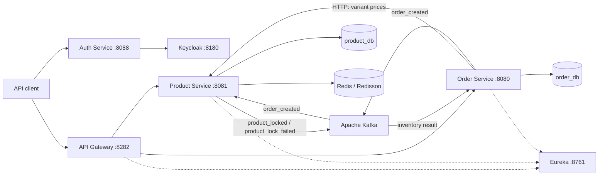
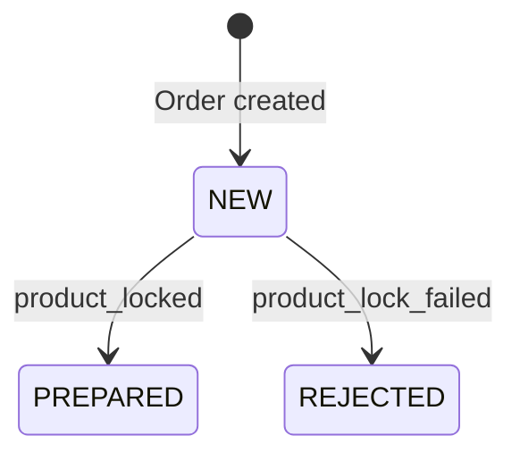

# E-commerce Microservices

A Java 21 and Spring Boot backend project exploring how independent services coordinate product pricing, order creation, and inventory updates. The core workflow combines synchronous HTTP communication with asynchronous Kafka events, with separate databases for product and order data.

The repository contains five independently runnable applications: Product, Order, Authentication, API Gateway, and Service Discovery. It is a portfolio and learning project focused on backend integration, transaction handling, and concurrent inventory processing.

[Architecture](#architecture) · [Order workflow](#order-workflow) · [Run locally](#run-locally) · [API examples](#api-examples) · [Testing](#testing) · [Current scope](#current-scope-and-next-steps)

## Highlights

- **Event-driven order processing:** Kafka connects order creation, inventory deduction, and order status updates.
- **Service-owned data:** Product and Order use separate PostgreSQL databases, exchanging DTOs and events instead of accessing each other's tables.
- **Concurrent inventory handling:** Redisson locks coordinate requests for the same variant set, while database row locks protect shared inventory rows.
- **Duplicate-event handling:** Persisted processing results keyed by order ID prevent repeated inventory deduction.
- **Failure handling:** Kafka consumers use retry topics with exponential backoff and dead-letter routing; insufficient stock produces an explicit rejection event.
- **Service discovery and routing:** Eureka resolves service instances for the Order service's WebClient and the Spring Cloud Gateway routes.
- **Keycloak integration:** A dedicated authentication service registers users and exchanges login credentials for access and refresh tokens.

## Architecture



Dashed connections represent service registration and discovery. Authentication is accessed directly on port `8088`; the gateway currently defines routes for `/products/**` and `/orders/**`.

| Application | Directory | Port | Responsibility |
| --- | --- | --- | --- |
| Product Service | [`product-service`](product-service/) | `8081` | Product variants, price lookup, inventory, and order-event processing |
| Order Service | [`order-service`](order-service/) | `8080` | Order validation, price snapshots, persistence, and status transitions |
| Auth Service | [`auth-service`](auth-service/) | `8088` | User registration and login through Keycloak |
| API Gateway | [`api-gateway`](api-gateway/) | `8282` | Discovery-based routing to Product and Order; Keycloak JWT configuration |
| Discovery Server | [`discovery-server`](discovery-server/) | `8761` | Eureka service registry |

### Technology stack

| Area | Technologies |
| --- | --- |
| Language and build | Java 21, Maven Wrapper |
| Application framework | Spring Boot 4.1.1, Spring Cloud 2025.1.3 |
| HTTP | Spring MVC, WebClient, Spring Cloud Gateway WebFlux |
| Persistence | Spring Data JPA, Hibernate, PostgreSQL 18 |
| Messaging | Apache Kafka 4.1.1, Spring Kafka |
| Coordination | Redis 7, Redisson 4.8.0 |
| Identity | Keycloak 26.8.0 container, Keycloak Admin Client 24.0.0 |
| Mapping and validation | MapStruct, Lombok, Jakarta Validation |
| Testing | JUnit Jupiter, Mockito, MockMvc, H2 |
| Local infrastructure | Docker Compose, Kafka UI, Redis Insight |

Versions above reflect the repository's POM and Compose configuration.

## Order workflow

1. The client submits variant IDs and quantities to `POST /orders`.
2. Order validates the request and retrieves current prices from Product through a load-balanced WebClient using the Eureka service name `product-service`.
3. Order stores a `NEW` order with its item quantities and price snapshots, then sends an `order_created` event.
4. Product consumes the event, checks for a previously processed order, locks the relevant inventory rows, and validates every requested quantity before making any deduction.
5. Product commits the inventory result and publishes either `product_locked` or `product_lock_failed`.
6. Order consumes the result and transitions to `PREPARED` or `REJECTED`. The client can retrieve the latest state with `GET /orders/{orderId}`.



| Topic | Producer | Consumer | Meaning |
| --- | --- | --- | --- |
| `order_created` | Order | Product | Request inventory processing for an order |
| `product_locked` | Product | Order | All requested quantities were deducted successfully |
| `product_lock_failed` | Product | Order | Inventory processing was rejected, with a failure reason |

Despite the event name `product_locked`, successful processing **deducts stock immediately**. There is no reservation expiry or payment workflow. `PREPARED` means inventory was allocated successfully.

### Consistency and failure handling

- **All-or-nothing inventory updates:** Missing inventory or insufficient stock rejects the order without partially deducting available items.
- **Idempotent inventory processing:** The `processed_orders` table stores the result under a unique order ID. Replayed events return the stored result.
- **Two levels of locking:** Redis lock keys contain the sorted variant IDs. Orders with overlapping but different variant sets can have different Redis keys, so ordered pessimistic database locks remain essential.
- **Bounded retries:** Consumers are configured for three total attempts, with 1-second and 2-second retry delays. `BusinessException` is excluded from retries; retry exhaustion routes failed records to dead-letter topics.
- **Eventual consistency:** The create-order response represents the initial order state. Inventory processing and final status updates happen asynchronously.

Database writes and Kafka publication are not atomic. In particular, `order_created` is sent asynchronously inside the order transaction, without waiting for broker acknowledgement. The current implementation has no transactional outbox or exactly-once guarantee.

## Repository layout

```text
ecommerce-microservices/
├── product-service/        # Catalog and inventory application
├── order-service/          # Order application and product HTTP client
├── auth-service/           # Keycloak registration and login application
├── api-gateway/            # Reactive API gateway
├── discovery-server/       # Eureka registry
├── docker/postgres/
│   ├── init.sql            # Databases and initial tables
│   └── seed-test-data.sql  # Repeatable catalog and inventory demo data
├── docker-compose.yml     # Infrastructure and administration tools
└── .env.example            # Local environment template
```

Each application has its own `pom.xml` and Maven Wrapper. **There is no root Maven aggregator.** Compose runs infrastructure, while the Java applications run separately.

Service directories and Maven artifact IDs use lowercase kebab-case. Java packages follow `com.mudotet.ecommerce.<service>`, and all applications use `src/main/resources/application.yaml`. Kafka topic names and consumer group IDs are retained to preserve the existing messaging contracts and offsets.

## Run locally

### 1. Prerequisites and configuration

Install JDK 21 and Docker with Docker Compose. Maven is provided by each application's wrapper. Clone the repository:

```bash
git clone https://github.com/mudotet/ecommerce-microservices.git
cd ecommerce-microservices
```

The shell examples below use Bash or Zsh and start from the repository root; Windows users can use `mvnw.cmd` for Maven commands.

Create your local environment file if it does not already exist:

```bash
cp .env.example .env
```

Set `POSTGRES_USER`, `POSTGRES_PASSWORD`, and `KEYCLOAK_ADMIN_PASSWORD` in `.env`. Keep local credentials out of version control. Set `KEYCLOAK_CREDENTIALS_SECRET` after configuring the Keycloak client in step 4.

Compose reads `.env` automatically. Spring Boot does not load it in this repository, so run the following in **each terminal used to launch Product, Order, or Auth**:

```bash
set -a
. ./.env
set +a
```

In IntelliJ IDEA, set `POSTGRES_USER` and `POSTGRES_PASSWORD` in the Product and Order run configurations, and `KEYCLOAK_CREDENTIALS_SECRET` in Auth. Use JDK 21 for each application.

### 2. Start the core infrastructure

```bash
docker compose up -d postgres kafka redis kafka-ui redis-insight
docker compose ps
```

Wait for PostgreSQL, Kafka, and Redis to become healthy before starting the business services.

| Dependency | Local address | Notes |
| --- | --- | --- |
| PostgreSQL | `localhost:5433` | Separate `product_db` and `order_db` databases |
| Kafka | `localhost:9092` | Host applications use this listener; Docker clients use `kafka:29092` |
| Redis | `localhost:6379` | Redisson uses the local Redis connection |
| Kafka UI | [localhost:8082](http://localhost:8082) | Inspect topics, records, and consumer groups |
| Redis Insight | [localhost:8001](http://localhost:8001) | Inspect the local Redis instance |

On a fresh PostgreSQL volume, Compose runs [`init.sql`](docker/postgres/init.sql) automatically. For an existing volume that predates these databases or tables, apply it manually:

```bash
docker compose exec -T postgres sh -c 'psql -U "$POSTGRES_USER" -d postgres' < docker/postgres/init.sql
```

Load the demo catalog and stock used by the API examples:

```bash
docker compose exec -T postgres sh -c 'psql -U "$POSTGRES_USER" -d product_db' < docker/postgres/seed-test-data.sql
```

The seed script preserves existing rows and quantities when rerun. Changing `.env` does not change the credentials of an already initialized PostgreSQL volume.

### 3. Start Discovery, Product, and Order

Run each application in a separate terminal, in this order. The commands assume the repository root as the working directory.

```bash
# Terminal 1
cd discovery-server
./mvnw spring-boot:run
```

```bash
# Terminal 2 — load the datasource variables from step 1 first
cd product-service
./mvnw spring-boot:run
```

```bash
# Terminal 3 — load the datasource variables from step 1 first
cd order-service
./mvnw spring-boot:run
```

Open the [Eureka dashboard](http://localhost:8761) and wait for `product-service` and `order-service` to register before creating orders. Verify the HTTP endpoints:

```bash
curl http://localhost:8081/products/health
curl http://localhost:8080/orders/health
```

These are simple application endpoints, not dependency readiness checks. The core order demo can now run directly through port `8080`.

### 4. Configure Keycloak and start Auth

```bash
docker compose up -d keycloak
```

Open the [Keycloak Admin Console](http://localhost:8180). On first initialization, Compose uses `KEYCLOAK_ADMIN_USERNAME` and `KEYCLOAK_ADMIN_PASSWORD` from `.env` for the bootstrap administrator. An existing Keycloak volume retains its configured administrator account.

Configure the local identity provider:

1. Create the realm `microservices-learning`.
2. Create an OpenID Connect client named `backend` with **Client authentication**, **Service accounts roles**, and **Direct access grants** enabled.
3. Assign the client's service account the `manage-users` client role from `realm-management`, and ensure that role is included in the client's role scope mappings.
4. Copy the generated client secret into `KEYCLOAK_CREDENTIALS_SECRET` in `.env`, then load the environment in the Auth terminal as shown in step 1.

See the [Keycloak Server Administration Guide](https://www.keycloak.org/docs/latest/server_admin/index.html) for client and service-account configuration.

Start Auth from the repository root in another terminal:

```bash
# Load .env from the repository root as shown in step 1 first.
cd auth-service
./mvnw spring-boot:run
```

The default realm, client ID, and server URL match the setup above. If you change them, also override the corresponding application properties. There is no automatic realm import in this repository.

### 5. Start the gateway

From the repository root in another terminal:

```bash
cd api-gateway
./mvnw spring-boot:run
```

The gateway listens on `http://localhost:8282` and resolves Product and Order through Eureka. Its current configuration includes OAuth2 resource-server dependencies and Keycloak issuer/JWK URLs. Security rules and protected-route integration tests remain in progress; the direct-service examples below are the documented demo path.

To stop Java applications, press `Ctrl+C` in their terminals. To stop the infrastructure while retaining named volumes, run from the repository root:

```bash
docker compose down
```

## API examples

### Create an order and check its status

The seed script inserts the following variants on first run:

| Variant ID | Name | Unit price | Initial stock |
| --- | --- | --- | --- |
| `30000000-0000-0000-0000-000000000001` | T-Shirt Black M | `100000` | `10` |
| `30000000-0000-0000-0000-000000000002` | T-Shirt White L | `120000` | `2` |
| `30000000-0000-0000-0000-000000000003` | Mug White | `80000` | `0` |

Create an order for two units of the first variant:

```bash
curl -X POST http://localhost:8080/orders \
  -H 'Content-Type: application/json' \
  -d '{
    "items": [
      {
        "productVariantId": "30000000-0000-0000-0000-000000000001",
        "quantity": 2
      }
    ]
  }'
```

The response uses a `data`, `message`, and `timestamp` envelope. `data` contains the order `id`, initial `NEW` status, `totalAmount`, `failureReason`, `createdAt`, and item details. Prices are fetched from Product; the client does not supply them.

Copy `data.id` from the response and query the order again after the Kafka consumers process the events:

```bash
curl http://localhost:8080/orders/REPLACE_WITH_ORDER_ID
```

With sufficient stock, the status becomes `PREPARED`. To exercise rejection, submit a new order using the zero-stock Mug variant; its status should become `REJECTED` with `failureReason` set to `Insufficient stock`. Inspect the three business topics in Kafka UI to follow the flow. Repeated successful demo orders consume the seeded stock.

### Register and log in

After completing the Keycloak setup:

```bash
curl -X POST http://localhost:8088/auth/register \
  -H 'Content-Type: application/json' \
  -d '{
    "username": "demo-user",
    "email": "demo@example.com",
    "password": "DemoPassword123!",
    "firstName": "Demo",
    "lastName": "User"
  }'

curl -X POST http://localhost:8088/auth/login \
  -H 'Content-Type: application/json' \
  -d '{"username":"demo-user","password":"DemoPassword123!"}'
```

Login returns Keycloak token fields, including `access_token`, `refresh_token`, `expires_in`, and `token_type`. Users must satisfy the realm's profile and required-action settings before password login can succeed.

### Endpoint reference

Paths below are relative to the owning service's address. Catalog routes are listed as implemented interfaces; see the scope notes before relying on catalog creation.

| Service | Method | Path | Purpose |
| --- | --- | --- | --- |
| Product | `GET` | `/products/health` | Application health message |
| Product | `GET` | `/products` | Catalog listing route |
| Product | `GET` | `/products/{productVariantId}` | Catalog lookup route by variant ID |
| Product | `PUT` | `/products` | Product creation route; mapping work remains |
| Product | `POST` | `/products/order-items` | Internal price lookup; body is an array of variant UUIDs |
| Order | `GET` | `/orders/health` | Application health message |
| Order | `POST` | `/orders` | Create an order for asynchronous inventory processing |
| Order | `GET` | `/orders/{orderId}` | Read order details and current status |
| Auth | `GET` | `/auth/health` | Application health message |
| Auth | `POST` | `/auth/register` | Create a Keycloak user |
| Auth | `POST` | `/auth/login` | Exchange username/password for Keycloak tokens |

## Testing

Run tests independently from the repository root:

```bash
(cd product-service && ./mvnw test)
(cd order-service && ./mvnw test)
(cd auth-service && ./mvnw test)
(cd discovery-server && ./mvnw test)
(cd api-gateway && ./mvnw test)
```

The source includes focused checks for:

- Order request validation, price snapshots, total calculation, and product-client error handling.
- Order transitions for successful, rejected, duplicate, and conflicting inventory results.
- Inventory rejection, duplicate events, transaction rollback, concurrent orders, and overlapping variant sets.
- Auth login request handling, token responses, and propagated Keycloak errors.
- Application context loading for the platform services.

Product integration tests use H2 and an in-process lock substitute by default. To exercise those tests with a real local Redis instance:

```bash
cd product-service
./mvnw test -Dinventory.tests.redis-address=redis://127.0.0.1:6379
```

Order tests use mocked external dependencies, and Auth tests mock Keycloak interactions. These tests do not replace a full PostgreSQL/Kafka/Keycloak integration run. `BaseClassesCheck` is a standalone assertion program, not a JUnit test.

To build an application JAR, run `./mvnw package` inside that application's directory. Output is written to its `target/` directory.

## Current scope and next steps

The central demo is order creation followed by asynchronous inventory processing. Areas for continued development include:

- **Reliable event publication:** Add an outbox and recovery strategy for the database/Kafka publication gap.
- **Catalog completion:** Finish product creation mappings and entity relationships, and add integration coverage for catalog endpoints. The demo currently uses SQL seed data.
- **Security integration:** Complete and test gateway authorization rules and service access controls. Product and Order currently expose direct HTTP endpoints without application-level authentication.
- **Deployment configuration:** Automate Keycloak realm setup and replace Hibernate `ddl-auto: update` with versioned database migrations.
- **Operational coverage:** Add full-stack integration tests, tracing, metrics, and a documented dead-letter recovery process.

Payment, shipping, cancellation, and inventory compensation are outside the current implementation.
